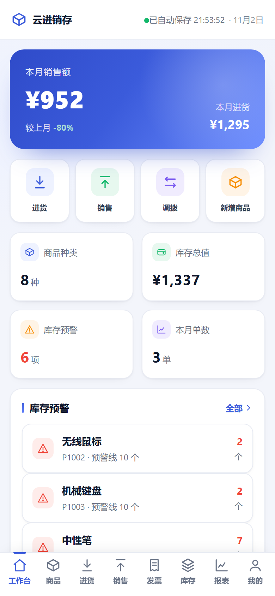
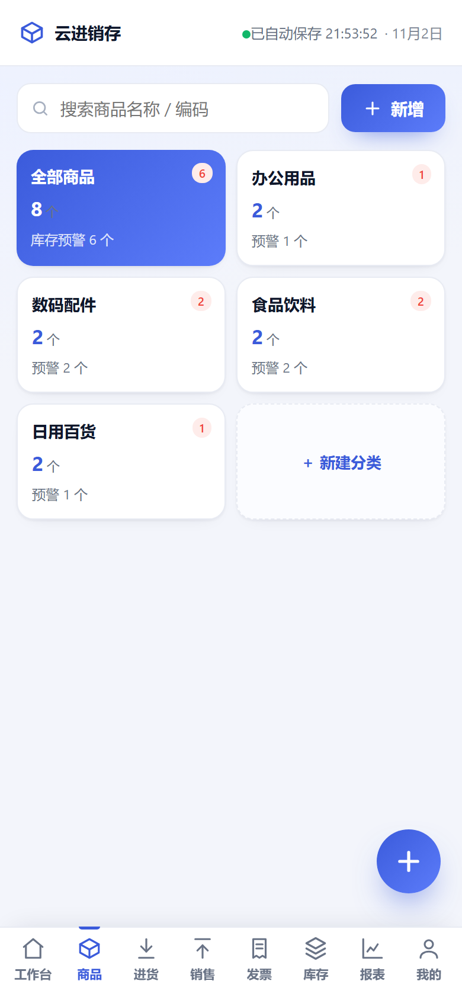
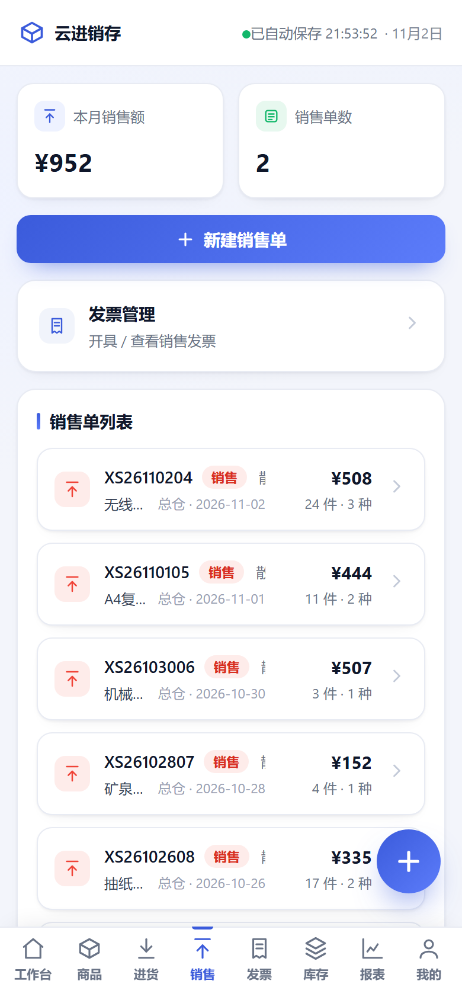
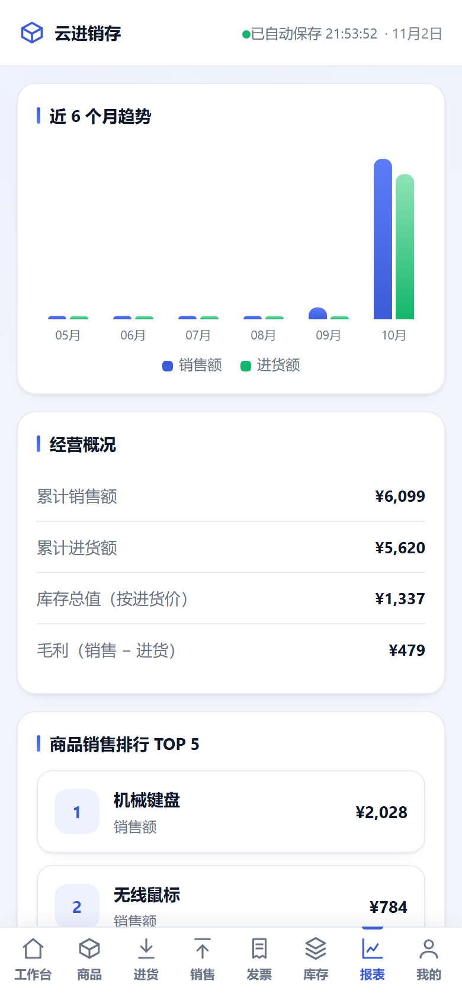

# 进销存 ERP · 单文件版

> 一个零依赖、单文件交付的进销存管理系统。双击即用，数据存自己手里。

面向小微商户（门店、批发、小仓库）的进销存工具。市面上同类 SaaS 普遍按年订阅、数据托管在厂商侧，停费即不可用；本项目把**交付成本**和**数据归属**作为核心约束来设计——整个系统是一个 HTML 文件，不需要安装、不需要服务器、断网也能跑，多设备之间可选接入免费云端同步。

- 体积：单文件 **210 KB**，3100+ 行，**0 框架 / 0 依赖 / 0 构建步骤**
- 成本：本地使用零成本；云端多设备方案运行在 Cloudflare Pages + Supabase 免费额度内
- 离线：支持 PWA，安装到桌面后断网可用

---

<p align="center">
  
  
  
  
</p>

> 截图为内置演示数据：在网址后加 `?demo=1` 就能看到同样的账本，不碰你的真实数据。

---

## 功能

| 模块 | 能力 |
|---|---|
| 工作台 | 今日流水、库存预警、最近单据、快捷入口 |
| 商品 | 商品档案、分类、单位、条码、进价/售价、安全库存、**从 Excel 批量导入报价表 / 库存表**、**导入可按批次撤销** |
| 进货 | 采购单录入、供应商关联、到货入库、库存自动增加 |
| 销售 | 销售单录入、客户关联、出库扣减、毛利计算、**客户专属价自动带出** |
| 库存 | 实时库存、多仓库、仓库间调拨、库存盘点与差异调整 |
| 发票 | 采购/销售发票登记、与单据关联、开票状态跟踪 |
| 往来 | 客户与供应商档案、应收应付、往来对账 |
| 报表 | 进销存汇总、商品流水、利润统计、期间筛选、**按客户导出 Excel 对账单（起止日期自选）** |
| 数据 | 本地备份导出/导入、一键清空、存储占用查看 |
| 同步 | 多设备云端同步、冲突合并、删除同步 |

> 「客户对账单」的 xlsx 是在浏览器里现拼出来的：自己实现了 CRC32 + store 模式 ZIP 打包和最小 OOXML 部件，没有引入 SheetJS 之类的库 —— 保持整站 0 依赖、0 构建。
>
> 导入走的是反方向：同样不引库，自己解 ZIP 中央目录 + `DecompressionStream('deflate-raw')` 解压，再解析 `sharedStrings` 与 `sheet1.xml`。报价表里一个商品出现十几次、每次价格不同是常态，所以按品名去重建档，价格差异落成「客户 × 商品」的专属价；同名但单位不同的（打包袋按包 / 按个）会拆成「打包袋（包）」「打包袋（个）」两个商品，而不是互相覆盖。库存表只要「品名 / 库存」两列，可覆盖或累加进指定仓库。每次导入都记一条批次，能整体撤销。

起止日期可以任选，也可以点「本月 / 上月 / 近 30 天 / 今年 / 全部」一键带出；整月区间文件名是 `客户名10月份对账明细.xlsx`，自定义区间则是 `客户名2026-10-05至2026-10-20对账明细.xlsx`。表格抬头取自己录入的公司名，客户名只落在文件名上。

所有单据支持**反审与删除**，删除时自动回退库存并连带清理关联流水与发票，保证账实一致。

---

## 技术选型：为什么是单文件

这不是"图省事"，是三个约束推出来的结果：

| 约束 | 现实情况 | 决策 |
|---|---|---|
| 分发 | 用户不会装软件、不会配环境，微信发个文件最现实 | 单 HTML，双击打开 |
| 设备 | 门店电脑老旧、浏览器版本低 | 原生 ES6+，不用框架运行时 |
| 网络 | 店里网络不稳定甚至没有 | 数据落 localStorage，离线全功能可用 |
| 维护 | 只有一个人在维护 | 无构建链，改完即发，没有 node_modules |

代价是单文件内的代码组织必须靠约定维持（分区块 + 命名前缀），以及没有组件化带来的复用成本。这个取舍在"个人维护 + 极小用户量"的场景下是成立的。

---

## 多设备同步是怎么做的

云端只存一份文档（单行 JSON），用**版本号乐观锁 + 双向合并**保证一致性，不引入长连接和 CRDT。

```
写入：PATCH ...?ver=eq.<当前版本>
      版本不符 → 影响 0 行 → 视为冲突
冲突：重新拉取云端快照 → 三方合并 → 重试（最多 3 轮）
合并：远端为底，本地新增补充；键排序序列化后比较，避免字段顺序造成误判
```

轮询周期 15 秒，另外在 `visibilitychange` / `focus` 时立即拉取，所以切回标签页就能看到另一端的改动。三个守卫避免同步打扰用户：正在输入时不推、弹窗打开时不推、后台标签页不拉。

### 踩过的两个坑

**1. 并集合并会让删除的记录复活。**
早期 `merge` 做的是两边取并集，结果 A 端删掉的商品，B 端一刷新又回来了——因为"删除"这个动作在两份数据里都没有痕迹。
解决办法是引入**同步基线 id 快照**：每次同步成功后记录各集合的 id 清单，下次同步时用「上次存在、这次某端缺失」推断删除意图。同时在清空数据、导入备份、断开同步时显式失效基线，否则版本升级后首次同步会把整库判定为"全被删除"。

**2. 并发写入会清空本地数据。**
冲突分支原本直接使用写入接口的返回值，但冲突时接口返回的是空结果，导致本地 DB 被覆盖成空。修复方式是冲突时**重新拉取云端快照**再合并，并且拿不到云端数据时绝不改动本地。

这两个 bug 都是双设备实测时才暴露的，单机自测永远发现不了。

---

## 快速开始

### 方式一：本地使用（不需要任何服务）

下载 `进销存ERP.html`，双击用浏览器打开即可。数据存在浏览器 localStorage 中。

> 换浏览器或清理浏览器数据会丢账，请定期用「数据 → 导出备份」保存 JSON。

### 方式二：云端访问 + 多设备同步（免费）

1. 把 `交付包/网页上传包/` 里的文件上传到 Cloudflare Pages（或任意静态托管）
2. 按 `交付包/Supabase-开通指南.md` 建表，拿到项目地址和 anon key
3. 在应用「我的 → 云同步」里填入这两项，其他设备填同样的值即可

### 方式三：自建服务器（局域网 / NAS）

`server/` 下是一个零依赖 Node 服务：密码登录、Cookie 会话、IP 限速、路径穿越防护、每日自动备份。

```bash
ERP_PASS=你的密码 node server/app.js
# 浏览器打开 http://localhost:8080
```

---

## 目录说明

```
进销存ERP.html          # 主程序（单文件，全部逻辑在这里）
交付包/                 # 面向用户的交付物
  ├─ 使用说明.md
  ├─ Supabase-开通指南.md / Supabase建表.sql
  ├─ 网页上传包/        # 静态托管用的 PWA 包（manifest + service worker）
  ├─ 自动备份/          # 数据库历史版本与恢复脚本
  └─ 多设备版-飞牛/     # 自建服务部署（Docker / Tailscale 外网访问）
server/                 # 自建服务端（Node，零依赖）
云同步建表.sql           # 云端表结构
```

---

## 已知限制

- 单个账套、单用户，没有权限体系（定位就是给一个人/一家店用）
- 云端同步是整文档覆盖式合并，数据量到几万条单据时需要改成分片同步
- 备份不包含商品图片（图片以 base64 存在浏览器里，体积大）
- 合并策略对"同一字段两端同时修改"采用后写优先，没有字段级时间戳

## License

MIT
